# Назначение системы

SOC — единая диспетчерская платформа для компании, которая организует рейсы
деловой авиации и всё, что нужно рейсу на земле: топливо, наземное
обслуживание, питание, транспорт, разрешения, противообледенительную
обработку. В одной системе собраны:

- **план полётов** — суточный план по бортам, карточка рейса со всей
  историей, проверка конфликтов расписания;
- **услуги и поставщики** — заказ услуги у поставщика с автоматическими
  проверками договора, цены и сроков, ответ поставщика, контроль SLA,
  исполнение с актом;
- **контрагенты** — клиенты, поставщики, договоры со сроками, рейтинг
  поставщиков;
- **финансы** — котировки и счета клиентам, платежи, заявки на оплату
  поставщикам, сверка счетов поставщиков, курсы валют, маржа рейса;
- **коммуникации** — письма поставщикам и клиентам по шаблонам на русском
  и английском, входящие, уведомления;
- **порталы** — личные кабинеты клиентов и поставщиков;
- **отчётность** — стандартные отчёты с выгрузкой, дашборды диспетчера
  и руководителя;
- **администрирование** — пользователи и роли, журнал аудита, правила SLA,
  подключения к внешним системам.

Система работает в браузере на компьютере, планшете и телефоне. Интерфейс
переведён на русский и английский языки.

## Демонстрационная установка

В демонстрационной установке база наполнена встроенным генератором данных.
**Компании, сотрудники, рейсы, договоры и суммы в ней вымышлены**; настоящие
только справочные сведения — коды аэропортов, типы воздушных судов, валюты —
и курсы Банка России. Данные построены относительно даты установки: история
за последний месяц и план на две недели вперёд. Все расчёты, проверки
и статусы на экранах выполнены системой по этим данным.

Учётные записи демонстрации и пароль приведены в «Инструкции по установке».

# Роли и доступ

Что видит пользователь, определяет его роль. Права проверяются на сервере:
недоступное роли не показывается в меню и не выдаётся по прямой ссылке.

| Роль | Работа в системе |
|---|---|
| Диспетчер | суточный план, рейсы, заказ услуг, поставщики и клиенты, слоты, сообщения, дашборд диспетчера |
| Финансист | котировки, счета, платежи, заявки на оплату, сверка, курсы валют, тарифы клиентов, финансовые отчёты |
| Руководитель | дашборд руководителя, все отчёты, просмотр операций и финансов |
| Администратор | всё перечисленное, а также пользователи, журнал аудита, правила SLA, подключения, производительность |
| Клиент | портал клиента: свои рейсы, заявка на рейс, свои документы |
| Поставщик | портал поставщика: свои заявки, подтверждение и исполнение, показатели, оплаты |

Клиент и поставщик видят только свои данные. Чужая запись для них
не существует: её нет ни в списках, ни по прямой ссылке. Клиент не видит
закупочных цен и поставщиков, поставщик — цен продажи и других поставщиков.

# Начало работы

## Вход

Откройте адрес системы в браузере, введите логин и пароль и нажмите
«Войти». В демонстрационной установке на экране входа показан список
учётных записей: щелчок подставляет логин.

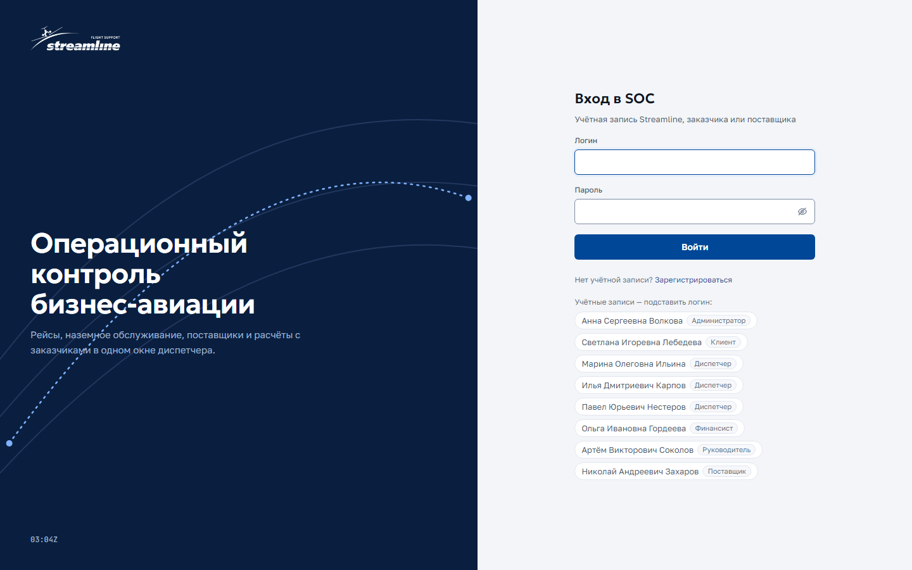

Для ролей, которым это предписано политикой безопасности, вход проходит
с вторым фактором: кодом из приложения-аутентификатора (Google
Authenticator, Яндекс Ключ и аналоги) или одноразовым резервным кодом.
При первом входе система предлагает привязать приложение и показывает
резервные коды — их нужно сохранить, повторно они не показываются. После
пяти неверных попыток учётная запись временно блокируется.

## Устройство экрана

- **Меню слева** сгруппировано по разделам: «Операции», «Финансы»,
  «Система». Его можно свернуть до значков.
- **Поиск по системе** — `Ctrl+K` (на Mac — `⌘K`): рейс, борт, клиент,
  аэропорт или экран по названию.
- **Колокольчик** — уведомления: подтверждения и отказы поставщиков,
  нарушения SLA, истекающие договоры, просроченные счета.
- **Часы** показывают время сервера в UTC. Время в системе всегда
  подписано зоной; в карточке рейса рядом с UTC показано местное время
  аэропортов.
- **Меню пользователя** — язык интерфейса (русский или английский)
  и выход.

Списки и таблицы показывают отдельно состояние загрузки, пустой список
и ошибку с объяснением, что делать. Основные действия доступны
с клавиатуры.

## Главный экран

После входа открывается главный экран роли. У диспетчера — дашборд:
ближайшие вылеты, рейсы за сутки, нарушения SLA, заявки с просроченным
лидтаймом, конфликты расписания, состояние парка.

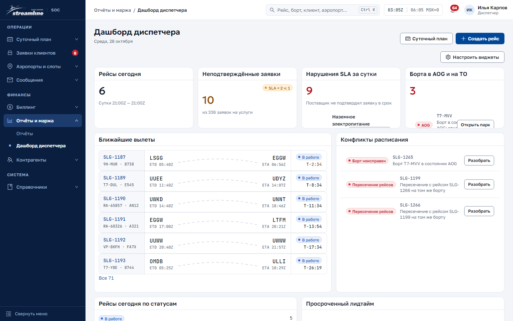

Виджеты настраиваются кнопкой «Настроить виджеты»: их можно убрать,
вернуть, переставить и изменить размер. Раскладка сохраняется за
пользователем.

# Операции

## Суточный план

«Операции → Суточный план» — основной экран диспетчера. Два вида:
**планшет** (диаграмма по бортам) и **таблица**.

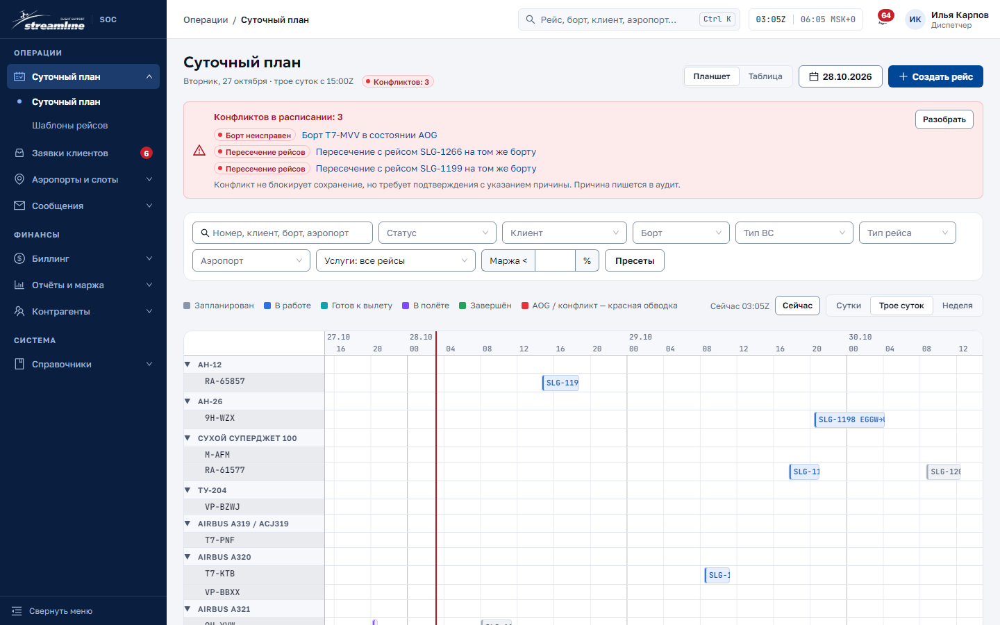

На планшете строка — борт, полоса — рейс; цвет полосы — статус рейса.
Вертикальная линия — текущее время сервера. Масштаб — сутки, трое суток,
неделя. Рейсы с конфликтом выделены.

**Перенос рейса** — перетащите полосу на другое время или другой борт.
Сервер проверяет расписание: если перенос создаёт конфликт (пересечение
рейсов борта, недостаточное время на разворот, борт в AOG или на
техобслуживании, истёкший допуск борта), система показывает конфликты
и просит подтвердить перенос с указанием причины. Причина пишется
в журнал.

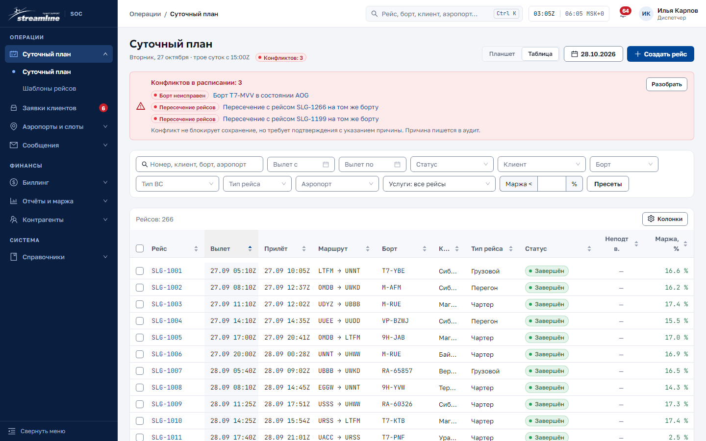

В таблице — фильтры по периоду, статусу, клиенту, борту и аэропорту,
сохраняемые наборы фильтров, выбор колонок и выгрузка в Excel. Отмеченные
рейсы можно обработать разом: перевести в другой статус или назначить
поставщика черновым заявкам.

**Новый рейс** — кнопка «Создать рейс»: клиент, аэропорты вылета и прилёта,
время вылета, борт, тип рейса. Расстояние, время в пути, время прилёта
и плановое топливо система считает сама по справочникам аэропортов и типов
воздушных судов.

**Шаблоны рейсов** («Суточный план → Шаблоны рейсов») — для регулярных
направлений: маршрут, местное время вылета, дни недели. Из шаблона
генерируется серия рейсов на период; местное время переводится в UTC
на каждую дату отдельно, с учётом перехода на летнее время.

## Карточка рейса

Карточка открывается щелчком по рейсу. Вкладки: «Обзор», «Услуги»,
«Финансы», «Документы», «История».

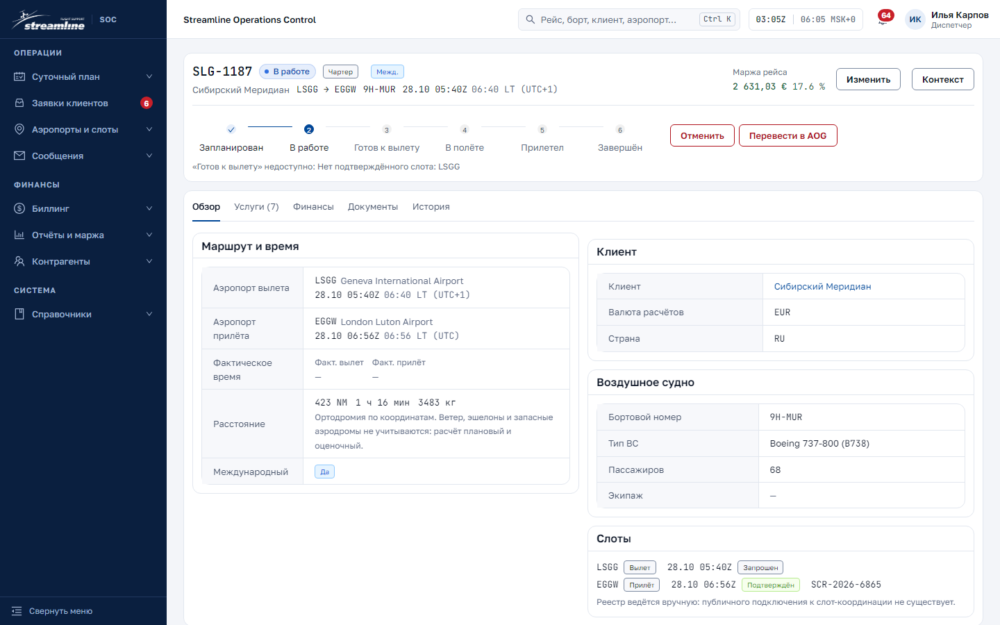

**Панель статуса** показывает текущий статус и доступные переходы.
Жизненный цикл рейса:

| Статус | Смысл |
|---|---|
| Запланирован | рейс заведён, услуги ещё не заказаны |
| В работе | идёт подготовка: заказаны услуги |
| Готов к вылету | все услуги подтверждены, разрешения и слоты получены |
| В полёте | рейс вылетел |
| Прилетел | рейс приземлился; оформляются акты и счёт |
| Завершён | услуги закрыты, счёт клиенту выставлен |
| Отменён | рейс отменён; заявки поставщикам отменяются |
| AOG / задержка | рейс задержан неисправностью борта |

Если переход недоступен, панель перечисляет невыполненные условия:
например, «не подтверждена заявка на топливо» или «международный рейс:
нет подтверждённого разрешительного документа». Статус меняется только
переходом — напрямую его изменить нельзя.

**История** — все изменения рейса и его заявок из журнала аудита: кто,
когда и что изменил, значения до и после.

## Заказ услуг

Вкладка «Услуги» карточки рейса — заявки на услуги по плечам вылета
и прилёта.

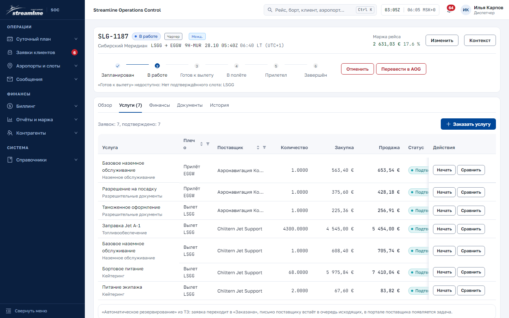

Кнопка «Заказать услугу» открывает мастер:

1. **Услуга и плечо** — что заказать и где: в аэропорту вылета или прилёта.
   Для услуги запрашиваются обязательные сведения: для топлива — марка
   и объём, для питания — число пассажиров и класс меню, для стоянки —
   часы и так далее.
2. **Поставщик** — таблица кандидатов: цена, расстояние, рейтинг и влияние
   на маржу рейса. Подбор — по цене, близости, рейтингу или взвешенно,
   в том числе своими весами.
3. **Проверки** — система проверяет заказ до отправки и ещё раз при
   отправке:
   - услугу в аэропорту оказывает хотя бы один поставщик с действующей
     ценой;
   - у выбранного поставщика действует договор на дату оказания;
   - цена действует на дату оказания;
   - соблюдён лидтайм — минимальный срок заказа.

   Первые три проверки блокирующие. Нарушение лидтайма можно подтвердить
   с причиной — она пишется в журнал.

При заказе в заявку копируются **закупочная цена и условия договора на этот
момент**. Последующее изменение прайса или договора не меняет уже
оформленную заявку. Поставщику уходит письмо на языке его контактного
лица.

Жизненный цикл заявки: **Черновик → Заказана → Подтверждена → В процессе →
Выполнена**, а также **Отклонена** и **Отменена**.

- **Ответ поставщика.** Поставщик подтверждает или отклоняет заявку
  в своём портале (или диспетчер отмечает ответ, пришедший письмом).
  Срок подтверждения задаётся правилами SLA; не подтверждённая к сроку
  заявка отмечается нарушением SLA, диспетчеры получают уведомление.
- **Отказ и переназначение.** Отклонённую заявку переназначают другому
  поставщику: создаётся новая заявка со ссылкой на прежнюю, отказ
  остаётся в истории. Пока отказ не разобран, рейс не может перейти
  в «Готов к вылету».
- **Исполнение.** Для закрытия заявки указываются фактическое время
  начала и окончания и фактическое количество (например, сколько топлива
  залито на самом деле). Для части услуг обязателен акт выполненных
  работ — файл прикладывается к заявке. Закупка и счёт клиенту
  считаются по факту.
- **Заявка на оплату** поставщику создаётся автоматически, когда услуга
  выполнена.

## Заявки клиентов и слоты

**Заявки клиентов** — запросы на рейсы, отправленные из портала клиента.
Диспетчер принимает заявку (создаётся рейс) или отклоняет её с причиной;
клиент видит решение в портале.

**Слоты** — реестр слотов в координируемых аэропортах: запрошенные,
подтверждённые, отклонённые, с номером сообщения координатора. Без
подтверждённого слота рейс в координируемый аэропорт не переходит
в «Готов к вылету».

# Контрагенты

## Поставщики

«Контрагенты → Поставщики» — реестр поставщиков с отбором по категории
услуг и аэропорту.

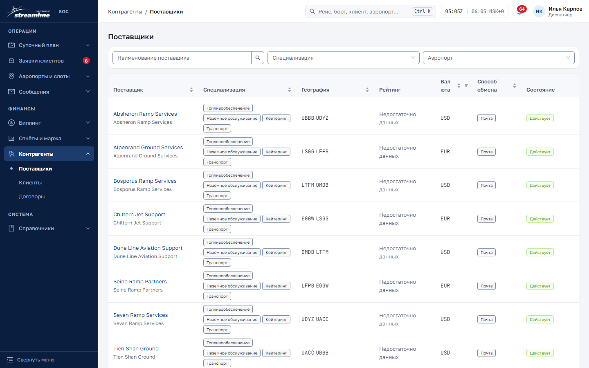

Карточка поставщика: реквизиты, контактные лица и язык переписки,
категории услуг, обслуживаемые аэропорты, сертификаты со сроками, условия
расчётов, договоры, цены и **рейтинг**. Рейтинг складывается из доли
подтверждений в срок, соблюдения сроков SLA, расхождений в сверке счетов
и ручной оценки качества; система показывает вклад
каждой составляющей. При меньше чем пяти заявках рейтинг не считается —
система пишет об этом, а не выводит случайное число.

Новые поставщики могут зарегистрироваться сами: регистрация с подтверждением
адреса почты попадает в очередь «Заявки поставщиков» администратора.

## Клиенты

Карточка клиента: реквизиты, контакты, валюта расчётов, условия оплаты
(предоплата, постоплата, отсрочка), кредитный лимит, рейсы, документы
и **тарифы** — правила, по которым считается цена продажи услуг этому
клиенту.

Тарифное правило задаётся одним из трёх способов: «Закупка + наценка»,
«Фиксированная цена», «Без наценки», при необходимости со скидкой.
Область правила — вся услуга, категория услуг, отдельный аэропорт. Если
подходят несколько правил, побеждает более конкретное, а при равенстве —
более позднее. **Песочница тарифов** показывает, какое правило сработает
для заданной услуги, аэропорта и количества, и объясняет расчёт по шагам.

## Договоры

«Контрагенты → Договоры» — договоры с поставщиками со «светофором» сроков:
действует, истекает (меньше 30 дней), истёк, расторгнут.

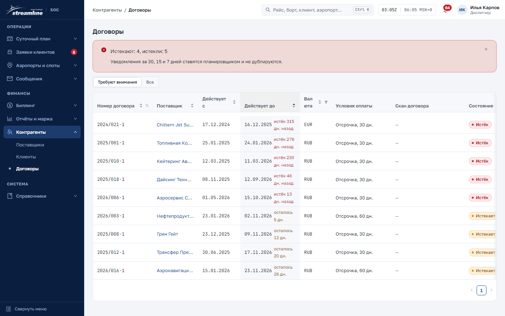

За 30, 15 и 7 дней до окончания договора диспетчеры получают напоминание.
Заказ у поставщика без договора, действующего на дату оказания услуги,
система не пропустит.

# Справочники

- **Каталог услуг** — услуги по категориям: единица измерения, лидтайм,
  обязательные сведения при заказе, нужен ли акт для закрытия.
- **Цены поставщиков** — цена услуги в аэропорту на период: валюта,
  минимальная стоимость, надбавки. Периоды одной услуги одного поставщика
  в одном аэропорту не пересекаются; смена прайса — новый период.
- **Парк ВС** — борта: тип, оператор, база, состояние (исправен,
  на техобслуживании, AOG) и допуски со сроками. Борт в AOG или
  с истёкшим допуском вызывает конфликт при планировании.
- **Аэропорты** — справочник аэропортов с кодами ИКАО и ИАТА, координатами,
  часовыми поясами и признаком координируемого аэропорта.

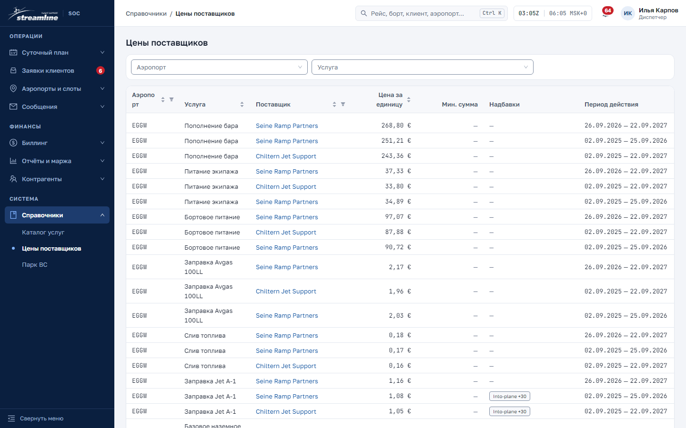

# Финансы

## Котировки и счета

**Котировка** — предварительный расчёт стоимости рейса для клиента
по плану услуг. **Счёт** выставляется по факту оказанных услуг; к счёту
прилагается сопоставление «план — факт» с котировкой.

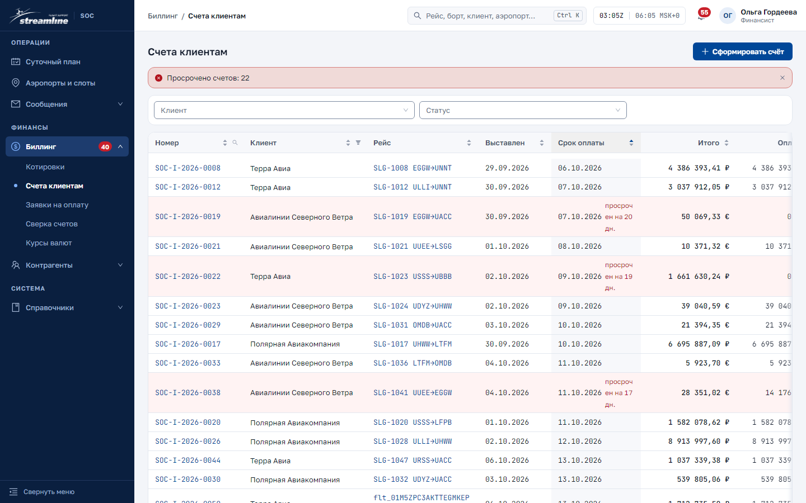

- Номера документов идут без пропусков, в том числе при одновременной
  работе нескольких пользователей.
- В документ копируются курсы валют на дату выставления. Последующие
  изменения курсов, цен и тарифов выставленный документ не меняют.
- Выставленный счёт не редактируется. Исправление — аннулирование
  с указанием причины и выпуск нового счёта со ссылкой на прежний.
- Документы выгружаются в PDF и Excel и отправляются клиенту письмом.
- НДС считается по справочнику ставок в зависимости от вида перевозки.

Статусы счёта: Черновик, Выставлен, Отправлен, Оплачен частично, Оплачен,
Просрочен, Аннулирован. Статус оплаты система выводит сама из
зарегистрированных платежей и срока оплаты.

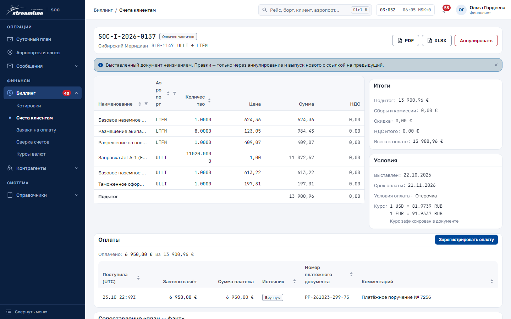

**Платежи клиентов** регистрируются с распределением по счетам; платёж
в другой валюте пересчитывается по курсу на дату поступления.

## Заявки на оплату поставщикам

Заявка на оплату создаётся автоматически при выполнении услуги — на сумму
по факту и со сроком оплаты по условиям договора, действовавшим при
заказе. Финансист согласует заявки; просроченные выделяются и попадают
в уведомления.

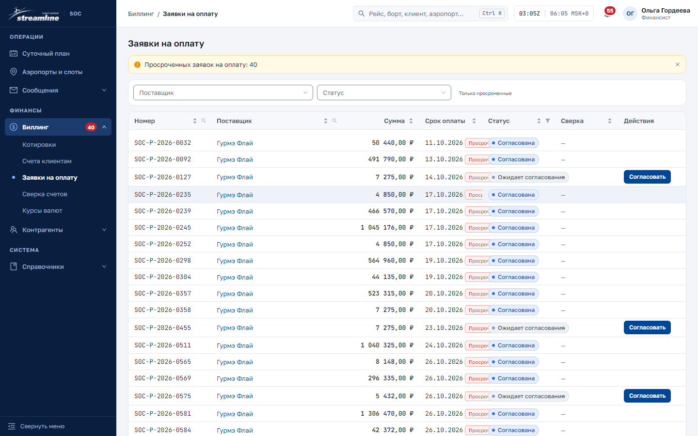

## Сверка счетов поставщиков

«Финансы → Сверка счетов» — загрузка счёта поставщика файлом Excel или CSV
(шаблон файла скачивается там же) и автоматическое сопоставление с
выполненными заявками по ключу «поставщик + аэропорт + дата + услуга».

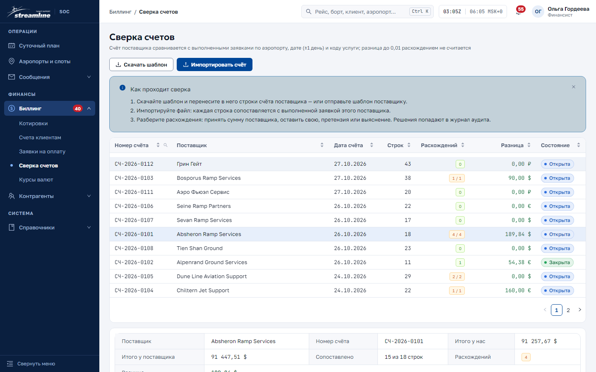

Расхождения четырёх видов:

| Вид | Смысл |
|---|---|
| Расхождение цены | услуга та же, сумма другая |
| Расхождение количества | поставщик выставил другое количество |
| Нет у нас | строка счёта, которой не соответствует ни одна заявка |
| Нет у поставщика | выполненная заявка, которую поставщик не выставил |

По каждому расхождению финансист принимает решение: принять сумму
поставщика, оставить нашу, выставить претензию или отложить для выяснения;
решение и комментарий пишутся в журнал. Коды услуг поставщика, которых нет
в справочнике соответствий, попадают в очередь сопоставления номенклатуры.

## Курсы валют

Курсы загружаются ежедневно с сайта Банка России. Экран «Курсы валют»
показывает текущие курсы и динамику. Документы и маржа считаются по курсу
на свою дату; если курса на дату ещё нет, используется последний
известный, и система показывает, от какого он числа.

## Маржа рейса

Вкладка «Финансы» карточки рейса — выручка, затраты и маржа в валюте
расчётов с клиентом, по каждой услуге. Три режима: «План» (все заявки),
«Факт» (только выполненные), «Смешанный» (выполненные по факту, остальные
по плану). Рейс с маржой ниже порога или отрицательной выделяется
на дашбордах и в отчётах.

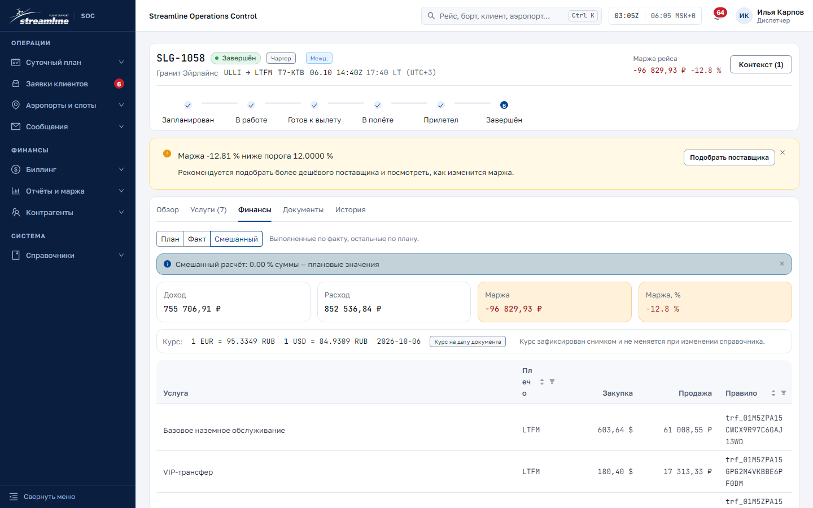

# Коммуникации

- **Исходящие** — все письма системы: заявки и отмены поставщикам,
  документы клиентам, напоминания, отчёты по подписке. Статусы: в очереди,
  отправлено, ошибка; при сбое отправка повторяется, письмо с ошибкой
  можно отправить снова.
- **Входящие** — письма поставщиков. Опознанные ответы (подтверждение,
  отказ) применяются к заявке одним действием; нераспознанные попадают
  в ручную очередь.
- **Шаблоны сообщений** — тексты писем на русском и английском с
  подстановкой данных рейса и заявки и предпросмотром. Язык письма
  выбирается по контактному лицу получателя.
- **Уведомления** — колокольчик в шапке экрана.

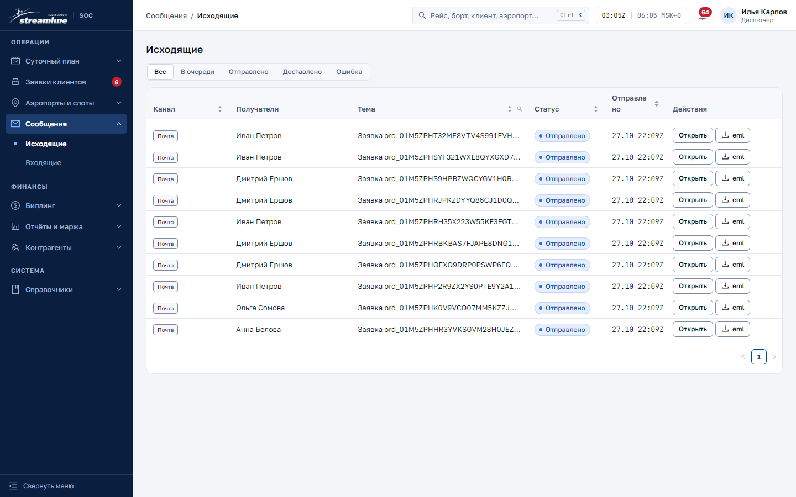

# Отчёты и дашборды

## Отчёты

«Отчёты и маржа → Отчёты» — стандартные отчёты:

1. рейсы за период с группировкой по клиенту, борту, аэропорту;
2. оказанные услуги по категориям и поставщикам;
3. финансовый: доходы, расходы и маржа по рейсам, клиентам, периодам;
4. поставщики: объём заказов, подтверждения в срок, нарушения SLA,
   расхождения в сверке;
5. дебиторская и кредиторская задолженность по срокам (0–30, 31–60,
   больше 60 дней);
6. реестр нарушений SLA;
7. журнал изменений рейсов за период.

Отчёт строится по заданным периоду, клиенту, поставщику, аэропорту,
категории и валюте представления; выгружается в PDF, Excel, CSV и XML.
**Подписка** отправляет отчёт письмом по расписанию: ежедневно,
еженедельно, ежемесячно.

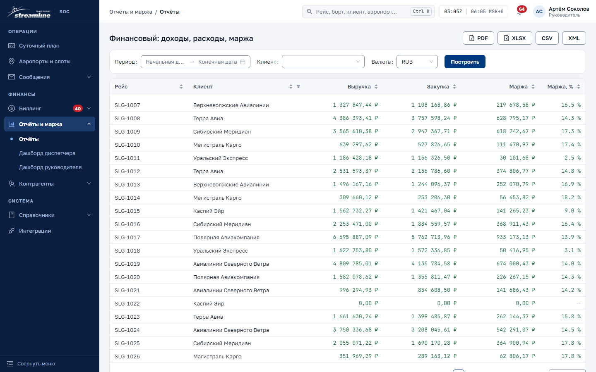

## Дашборд руководителя

Оборот, маржа, дебиторская и кредиторская задолженность, клиенты
по выручке, поставщики по обороту, рейсы с отрицательной маржой.

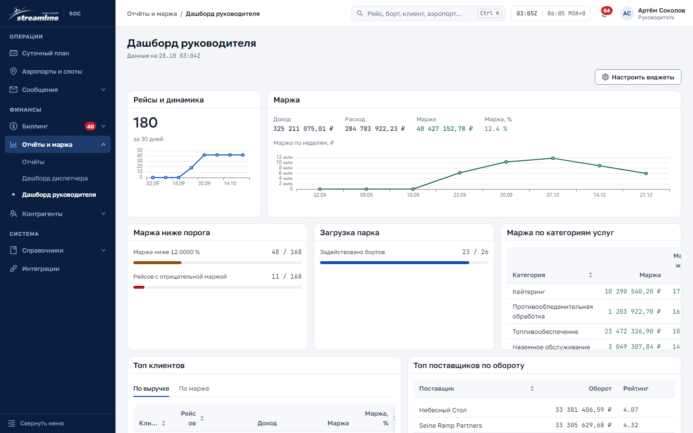

# Порталы клиентов и поставщиков

## Портал клиента

Клиент видит свои рейсы и их статусы, отправляет заявку на новый рейс
и получает свои котировки и счета; котировку можно принять или отклонить.
Закупочные цены и поставщики клиенту не показываются.

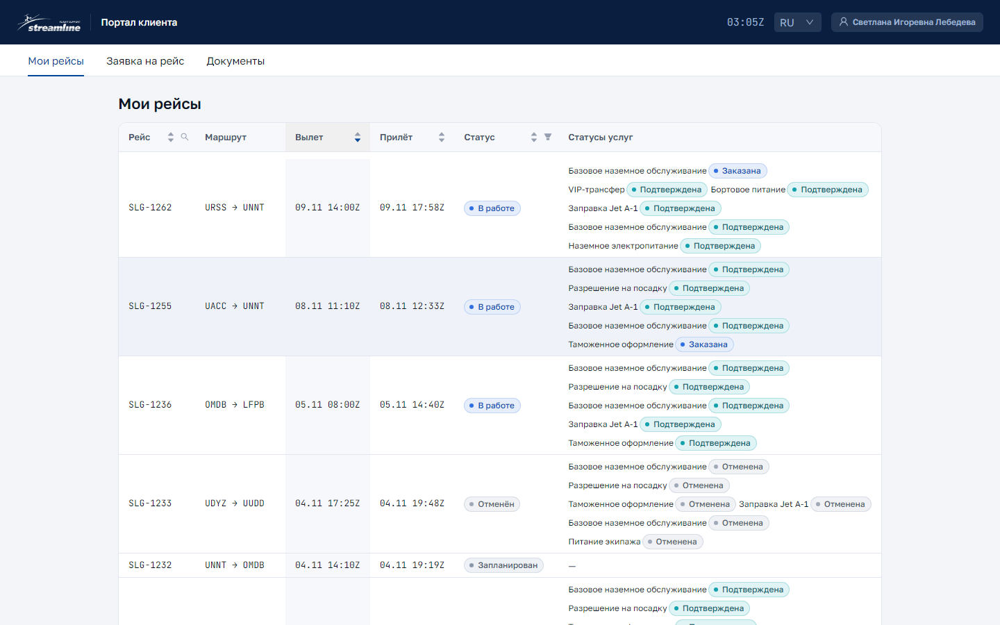

## Портал поставщика

Поставщик видит заявки, адресованные ему, и подтверждает или отклоняет их
в два действия. По выполненной заявке он указывает фактическое время
и количество и прикладывает акт. Там же — его показатели (рейтинг
и его составляющие) и заявки на оплату ему.

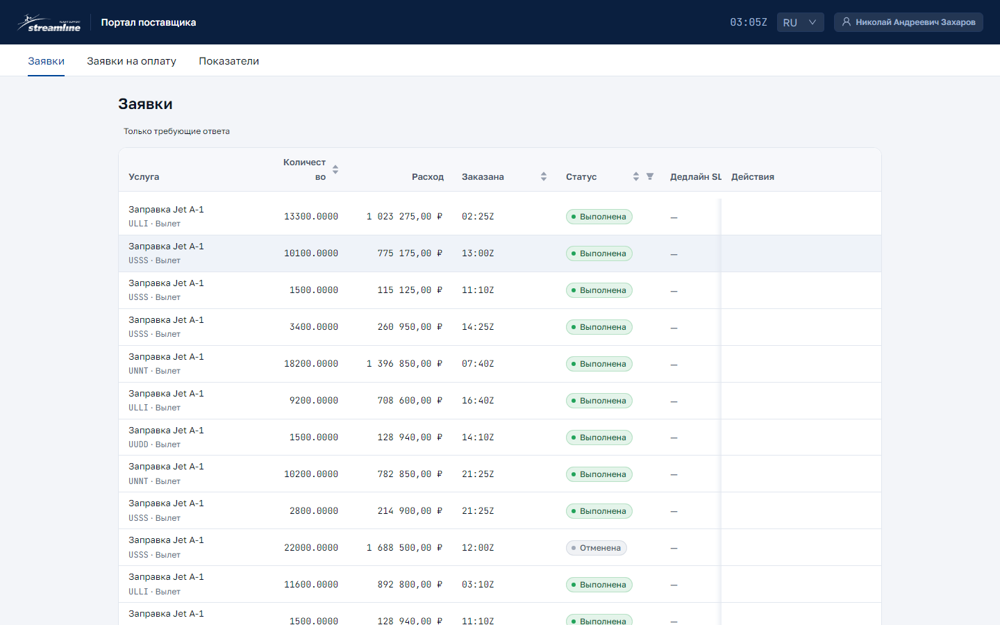

# Администрирование

- **Пользователи** — учётные записи и роли, состояние второго фактора.
  Для пользователей портала — привязка к клиенту или поставщику.
- **Заявки поставщиков** — очередь саморегистрации поставщиков на
  согласование.
- **Журнал аудита** — все действия пользователей и системы: кто, когда,
  какая запись, значения до и после. Журнал только пополняется: изменить
  или удалить запись нельзя, в том числе напрямую в базе данных.
- **Интеграции** — работающие подключения к внешним системам: доступность
  по последнему обмену, время последнего успешного обмена, кнопка
  «Проверить». Каждый обмен с внешней системой записывается в журнал
  обменов.
- **Правила SLA** — сроки подтверждения и исполнения по категориям услуг
  и отдельным поставщикам.
- **Производительность** — время открытия экранов у пользователей
  по замерам браузера.
- **Спецификация API** — описание программного интерфейса системы для
  подключения внешних систем.

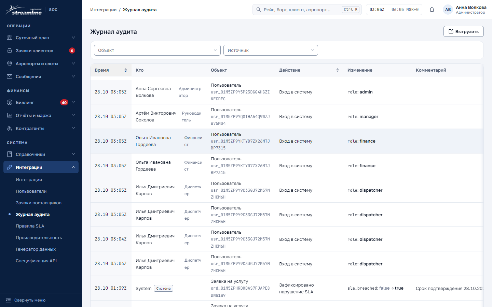

## Только в демонстрационной установке

- **Генератор данных** — пересоздание демонстрационного набора. Удаляются
  только записи генератора; введённое людьми остаётся.
- **Управление временем** — смещение и ускорение часов сервера для показа
  автоматических переходов (вылет и прилёт по времени, просрочка SLA
  и оплаты). Пока время смещено, часы в шапке это показывают.

В рабочей установке эти функции отключены.

# Подключения к внешним системам

| Система | Назначение | Состояние |
|---|---|---|
| Банк России | курсы валют | работает |
| Почтовый сервер | исходящая почта | работает |
| 1С:Бухгалтерия | обмен счетами, платежами, контрагентами | не подключена |
| Active Directory | вход под доменной учётной записью | не подключена |
| Почтовый ящик | разбор входящих писем поставщиков | не подключён |
| Электронный документооборот | обмен документами с ЭП | не подключён |
| Корпоративный мессенджер | уведомления | не подключён |
| BI-системы | аналитика на реплике базы | не подключены |

Подключения к корпоративным системам разрабатываются по мере получения
доступов к этим системам: адрес сервера, учётная запись, документация,
договор с оператором. Неподключённая система не подменяется: функции,
которые на ней держатся, недоступны, пока подключение не включено.
Разбор входящих писем в демонстрационной установке работает на письмах
генератора. Работающие подключения видны на экране «Интеграции».
